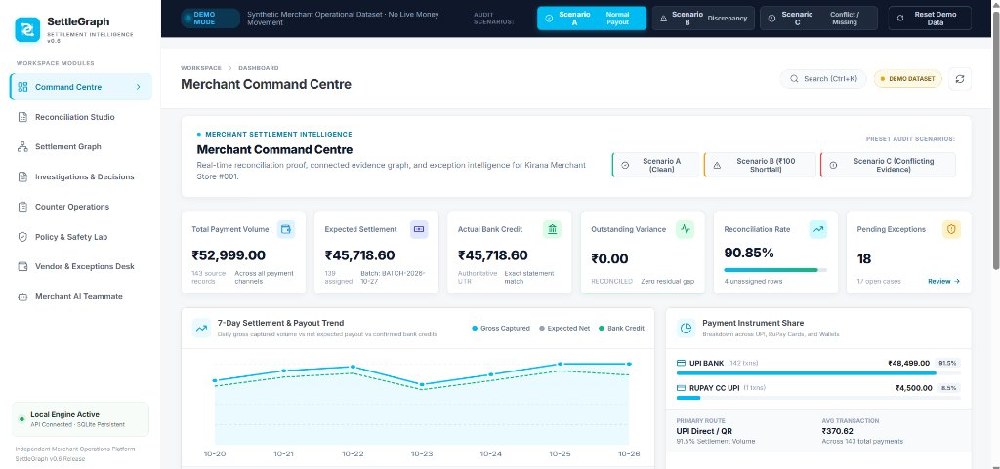
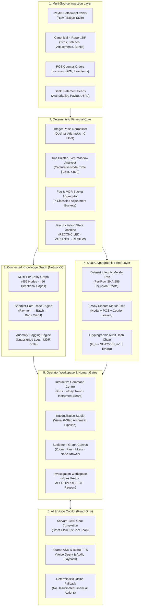
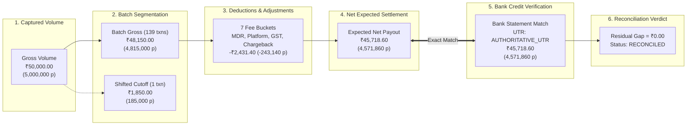
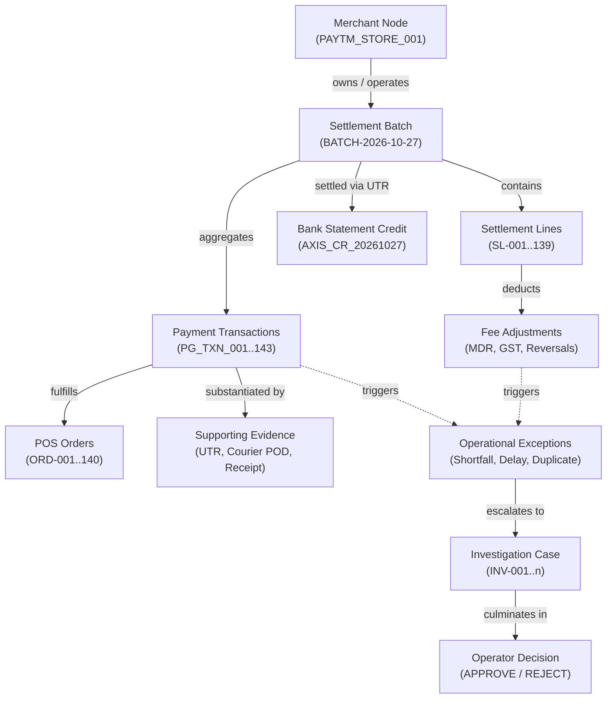
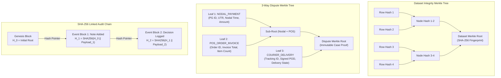
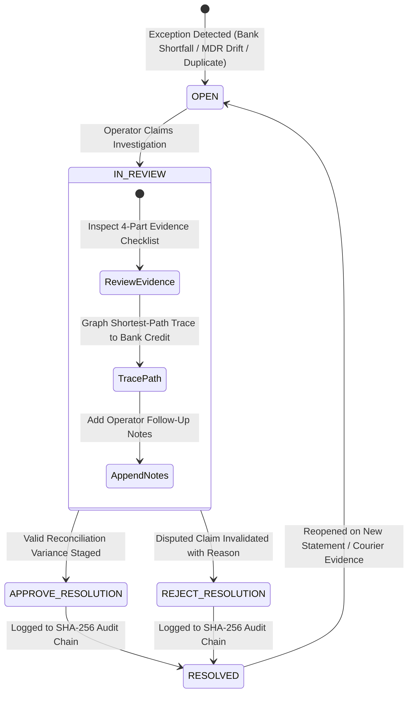

# SettleGraph 0.6 — Merchant Settlement Intelligence Platform

[](https://www.python.org/downloads/)
[](https://fastapi.tiangolo.com)
[](https://react.dev/)
[](https://www.typescriptlang.org/)
[](https://docs.pytest.org/)
[-green.svg)](#mathematical-integrity--financial-data-contracts)
[](#interactive-merchant-command-centre)

**Evidence-backed merchant settlement intelligence & exception-resolution platform** · Independent fintech operations workspace

SettleGraph connects merchant-side payment, payout batch, MDR fee adjustment, bank statement, POS order, and courier delivery evidence so operators can resolve payout discrepancies, reconcile fragmented accounts, investigate exceptions through explainable graph reasoning, and record immutable human decisions.

> **Key Differentiator:** *"From fragmented settlement records to connected, explainable and auditable merchant investigations."*
>
> **Honest Runtime Boundary:** Built-in fixtures are synthetic. The workbench runs locally with SQLite persistence and supports uploaded local CSVs and ZIP bundles. There is no live Paytm, NPCI, core bank, courier, or POS connection, no autonomous refund execution, and no live dispute submission. It assists human operators; it does not execute financial transactions autonomously.

---

## Workspace Preview


*Figure 1: SettleGraph 0.6 Merchant Command Centre — featuring the Paytm-inspired visual system (`#00BAF2`), real-time 6-KPI financial health grid, interactive 7-day settlement trends, payment channel breakdowns, and instant 1-click Preset Audit Scenario controls.*

---

## Live Deployments & Access Matrix

| Deployment Target | Environment | URL | Details |
|---|---|---|---|
| **Render Web App** | Production Static Site | **[settlegraph-frontend-shashank.onrender.com](https://settlegraph-frontend-shashank.onrender.com)** | Hosted on Render CDN, connected to Render API |
| **Render API Service** | Production Web Service | **[settlegraph-api-shashank.onrender.com](https://settlegraph-api-shashank.onrender.com)** | FastAPI backend running on Python 3.11 |
| **Render Health Check** | API Verification | **[settlegraph-api-shashank.onrender.com/api/health](https://settlegraph-api-shashank.onrender.com/api/health)** | Returns `{"ok": true, "version": "0.6.0"}` |
| **Cloudflare Edge Tunnel** | Instant Live Mirror | **[exclusively-arbitration-antibody-gasoline.trycloudflare.com](https://exclusively-arbitration-antibody-gasoline.trycloudflare.com)** | Single-port local tunnel on Cloudflare Global Edge |
| **Local Machine** | Native Localhost | **[http://127.0.0.1:8000](http://127.0.0.1:8000)** | Full-stack FastAPI + React SPA on port 8000 |

---

## System Architecture

### 1. End-to-End Platform Architecture



---

### 2. Deterministic Reconciliation Arithmetic Pipeline

SettleGraph enforces a strict arithmetic bridge where every paise is tracked through explicit, source-recorded reference identifiers:



---

### 3. 10-Tier Connected Entity Knowledge Graph

SettleGraph's signature feature is an interactive, multi-tier directed relationship graph comprising 10 distinct entity types:



---

### 4. Dual-Merkle Verification & Cryptographic Audit Chain



---

### 5. Operator Decision & Investigation Lifecycle



---

## What is Functional in SettleGraph 0.6

### 1. Interactive Merchant Command Centre
- **6-Metric Executive KPI Grid:** Real-time visibility into Total Payment Volume (₹52,999.00), Expected Settlement (₹45,718.60), Confirmed Bank Statement Credit (₹45,718.60), Outstanding Residual Gap (₹0.00 RECONCILED), Reconciliation Rate (90.85%), and Pending Exceptions (18).
- **Interactive 7-Day Trend Chart:** SVG line and area chart plotting Daily Gross Captured Volume, Net Expected Settlement, and Confirmed Bank Credits with hover data inspection.
- **Payment Channel Distribution:** Volume and percentage breakdown across UPI Direct (91.5%) and RuPay CC on UPI (8.5%).
- **Exception Intelligence & Ageing:** Categorized anomaly registers with `<24h`, `24–48h`, and `>48h` ageing breakdown.
- **Global Search Modal (`Ctrl+K`):** Instant search dialog across transactions, orders, UTRs, and batch identifiers with keyboard navigation (`↑`, `↓`, `Enter`, `Esc`).

### 2. Signature Feature: Interactive Settlement Graph
- **NetworkX Multi-Tier Topology:** Maps 456 entities across 10 distinct types with 456 directional relations.
- **Interactive Canvas Engine:** Smooth drag-to-pan, wheel zoom, zoom controls (`+`, `−`, reset), and auto-centering on search.
- **Entity Type Filtering:** 10 interactive filter pills (*Merchant, Batch, Payment, Order, Line, Adjustment, Bank Credit, Evidence, Exception, Investigation*).
- **Visual Highlight for Anomalies:** Unassigned transactions, unknown fee adjustments, and open disputes display prominent warning borders and dashed relations.
- **Slide-Over Entity Inspector:** Click any node to open metadata drawer, view raw source records, copy references, trace shortest paths, or launch a direct investigation.

### 3. Reconciliation Studio
- **Drag-and-Drop Ingestion:** Drag and drop canonical 4-report ZIP bundles or raw Paytm merchant CSVs with drag-hover feedback.
- **6-Step Arithmetic Pipeline:** Step-by-step arithmetic bridge:
  `Captured Volume → Batch Gross − Debit Adjustments = Expected Net vs Bank Credit → Reconciliation Verdict`.
- **Raw Paytm CSV Normalization:** Converts decimal currency strings into integer paise and displays mapped columns before staging.
- **Tabbed Transaction Register:** Categorized sub-tables for All, Matched (139), Unassigned (4), Shifted Cutoff, and Fee Adjustments.
- **Transaction Detail Drawer:** Side drawer showing gross volume, commission, GST, net payout, nodal timestamps, and match failure diagnosis.

### 4. Investigation Workspace & Decision Workflows
- **Case Register:** Persisted in SQLite `investigations` table with status tabs (`ALL`, `OPEN`, `RESOLVED`, `REJECTED`).
- **4-Part Evidence Checklist:** Verifies Payment PG record, Settlement Batch reference, Bank Statement credit, and Dispute Merkle leaf.
- **Operator Notes Feed:** Timestamped follow-up notes that persist across page reloads.
- **Operator Resolution Decisions:** Human-in-the-loop `APPROVE_RESOLUTION` or `REJECT_RESOLUTION` controls with required rationale.
- **Case Reopening:** Case lifecycle supports reopening resolved cases when new statements or evidence arrive.
- **Cryptographic Audit Chain:** Every case, note, and decision is cryptographically linked in a tamper-evident SHA-256 audit chain.

### 5. Judge-Ready 3-Scenario Demo Mode
- **Top Demo Bar:**
  - **Scenario A (Normal Settlement):** 100% matched payments, ₹0 residual, clean reconciliation baseline.
  - **Scenario B (Settlement Discrepancy):** Injects ₹100 bank credit shortfall and ₹10 MDR fee delta; demonstrates unexplained variance detection.
  - **Scenario C (Conflicting Evidence):** Injects unassigned late cutoff transaction and unclassified fee adjustment; requires operator investigation.
- **Reset Demo Data Action:** Restores baseline dataset with a confirmation modal.
- **URL Hash Persistence:** Navigation state (`#dashboard`, `#reconcile`, `#evidence`, `#audit`) persists across browser refreshes.

### 6. Dispute Policy Lab & Counter Operations
- **3-Way Merkle Dispute Verification:** Verifies integrity across Nodal Payment, POS Order Invoice, and Courier Delivery.
- **Controlled Fault Injection:** Corrupt OTP, alter invoice amount, contradict courier status, or simulate duplicate debit.
- **Duplicate Debit Shield:** Idempotent detection of identical order ID + paise amount within 120s; stages proposal for human review.
- **Mock POS Order Sync:** Idempotently updates local mock POS order state from `PAYMENT_PENDING` to `PAID`.
- **Vendor & Exceptions Desk:** 3-way PO/GRN/Invoice match, MSMED Act 15/45-day calculation, RBI bank rate toggle, Kirana decomposition, and RBI failed TAT monitor.
- **Merchant AI Teammate & Voice:** Read-only tool loop. When Sarvam is configured, supports Hindi/Hinglish chat and Saaras ASR; when unconfigured, falls back to deterministic local tools without fabricating responses.

---

## Mathematical Integrity & Financial Data Contracts

1. **Integer Paise Calculations (`Decimal`):**
   * All monetary inputs are converted to integer paise (`1 INR = 100 paise`).
   * No binary floating-point calculations (`float`) are permitted in financial paths.
   ```python
   def money(val: Any) -> int:
       if isinstance(val, int):
           return val
       cleaned = str(val).replace(",", "").replace("₹", "").strip()
       return int(Decimal(cleaned) * 100)
   ```

2. **Explicit Reference Matching:**
   * Payout batches and bank statement credits require exact, authoritative references (`payout_batch_id`, `utr_rrn`).
   * Membership is never inferred from timestamps alone.

3. **Strict Human Authority:**
   * SettleGraph assists operators in investigations; it never executes money movements, external refunds, or dispute submissions autonomously.

---

## Live Demo Walkthrough (3-Minute Script)

1. **Step 1: Merchant Command Centre (`#dashboard`)**
   * Review the 6 KPI cards: ₹52,999.00 TPV, ₹45,718.60 expected vs ₹45,718.60 actual bank credit, ₹0.00 residual gap, 90.85% reconciliation rate.
   * Hover over the 7-day trend chart to observe daily gross volume vs bank credits.
   * Inspect the Payment Channel distribution (UPI Direct 91.5%, RuPay CC 8.5%).

2. **Step 2: Interactive Settlement Graph (`#evidence`)**
   * Click the **Settlement Graph** tab.
   * Use zoom (`+`, `−`) and drag to explore the 456-node graph.
   * Click an entity filter pill (e.g. `Payment` or `Bank Credit`) to isolate entity types.
   * Click node `MERCHANT:PAYTM_STORE_001` or any transaction node to open the Slide-Over Entity Inspector.
   * Click **Trace Path to Bank Credit** to view the shortest path.

3. **Step 3: Test Scenario B (Discrepancy)**
   * In the top demo banner, click **Scenario B (Discrepancy)**.
   * The Command Centre instantly updates: Residual Gap shifts to **-₹110.00**, and status changes to `UNEXPLAINED_VARIANCE`.
   * Open the Settlement Graph to see the discrepancy highlighted on the bank credit and fee adjustment edges.

4. **Step 4: Investigation & Audit Trail (`#audit`)**
   * Navigate to **Investigations & Decisions**.
   * Open an existing investigation (e.g., `#INV-2026-001`).
   * Review the 4-part evidence breakdown.
   * Add an operator follow-up note in the timeline: *"Verified bank statement shortfall with Axis Nodal branch."*
   * Click **Approve Resolution** or **Reject Resolution** with an operator rationale.
   * Verify the new decision is cryptographically chained into the SHA-256 audit table.

5. **Step 5: Reset Demo**
   * Click **Reset Demo Data** in the top banner.
   * Confirm the modal dialog; the system returns cleanly to the baseline state.

---

## Quick Start (Local Setup)

### Prerequisites
* **Python 3.11+**
* **Node.js 20+** (npm 10+)
* **PowerShell** (Windows) or bash (macOS/Linux)

### 1. Launch Backend API
```powershell
.\start_backend.ps1
```
* **API Base URL:** [http://127.0.0.1:8000](http://127.0.0.1:8000)
* **Interactive OpenAPI Docs:** [http://127.0.0.1:8000/docs](http://127.0.0.1:8000/docs)
* **Health Check:** [http://127.0.0.1:8000/api/health](http://127.0.0.1:8000/api/health)

### 2. Launch Frontend Workbench
```powershell
.\start_frontend.ps1
```
* **Workbench UI:** [http://127.0.0.1:5173](http://127.0.0.1:5173)

### 3. Verify Full Project Suite
```powershell
powershell -ExecutionPolicy Bypass -File .\verify_project.ps1
```
Executes:
1. Python compile check (`compileall`).
2. Pytest backend regression suite (**121 passed tests**).
3. TypeScript transpilation (`npm run typecheck`).
4. Production bundle build (`npm run build`).

---

## Complete API Reference (v0.6)

| HTTP Method | Route | Description |
|---|---|---|
| `GET` | `/api/health` | Service health, version (0.6.0), and integration flags |
| `GET` | `/api/dashboard/stats` | Executive KPI cards, 7-day trend, channel share, and ageing |
| `POST` | `/api/demo/scenario/{scenario_id}` | 1-click activation of Demo Scenario A, B, or C |
| `GET`, `POST` | `/api/demo/reconcile` | Deterministic reconciliation calculation and fault simulation |
| `POST` | `/api/demo/reset` | Restore baseline synthetic source reports |
| `GET` | `/api/graph/overview` | Full multi-tier connected evidence graph (456 nodes & edges) |
| `GET` | `/api/graph/trace/{node_id}` | NetworkX shortest path trace from source node to bank credit |
| `GET`, `POST` | `/api/investigations` | List and create persisted investigations |
| `GET` | `/api/investigations/{id}` | Retrieve comprehensive investigation detail and notes |
| `POST` | `/api/investigations/{id}/notes` | Append operator follow-up note to investigation |
| `POST` | `/api/investigations/{id}/decision` | Record operator resolution decision (`APPROVE` / `REJECT`) |
| `POST` | `/api/investigations/{id}/reopen` | Reopen resolved case for re-audit |
| `POST` | `/api/import-zip` | Ingest and validate canonical 4-report ZIP bundle |
| `POST` | `/api/import/paytm-csv/preview` | Preview raw Paytm merchant CSV with paise column mapping |
| `POST` | `/api/import/paytm-csv/stage` | Stage mapped export without altering active ledger |
| `GET` | `/api/import/staged-paytm-exports` | List staged raw exports |
| `GET` | `/api/import/status` | Current active dataset metadata and source bundle state |
| `GET` | `/api/integrity/merkle` | Dataset Merkle root and per-record inclusion proofs |
| `POST` | `/api/disputes/{case_id}/evaluate` | 3-way Merkle evaluation with controlled fault injection |
| `POST` | `/api/operations/duplicate-debits/check` | Scan active payments for duplicate debit candidates |
| `GET` | `/api/approvals` | Retrieve local approval queue |
| `POST` | `/api/approvals/{id}/decision` | Record manual handoff decision for duplicate debit |
| `GET` | `/api/operations/pos-orders` | Retrieve mock POS orders list |
| `POST` | `/api/operations/orders/{id}/sync` | Idempotent mock POS order sync |
| `POST` | `/api/evidence-packet/compile` | Compile 4-exhibit review PDF |
| `GET` | `/api/evidence-packet.pdf` | Download compiled evidence PDF packet |
| `GET` | `/api/audit` | Retrieve local SHA-256 linked audit chain |
| `GET` | `/api/audit/verify` | Verify cryptographic hash integrity of audit chain |
| `GET` | `/api/integrations/status` | Provider integration readiness status |
| `POST` | `/api/integrations/sarvam/test` | Live test for configured Sarvam Chat and TTS models |

---

## Documentation Index

* [Full Functional Audit (Phase 1)](docs/FUNCTIONAL_AUDIT.md) — Comprehensive screen-by-screen audit register.
* [Implementation Report & Feature Classification](docs/IMPLEMENTATION_REPORT.md) — Working vs simulated feature classification.
* [Judge & Live Demonstration Guide](docs/DEMO_GUIDE.md) — 3-minute hackathon demo script and judge Q&A.
* [Live Readiness Roadmap & Production Contracts](docs/LIVE_READINESS_ROADMAP.md) — Production hardening requirements.
* [API Credentials & Integration Setup Guide](docs/INTEGRATION_SETUP_GUIDE.md) — Sarvam AI and external provider integration guides.
* [Design System Specification](docs/DESIGN_SYSTEM.md) — Paytm-inspired visual tokens and component guidelines.
