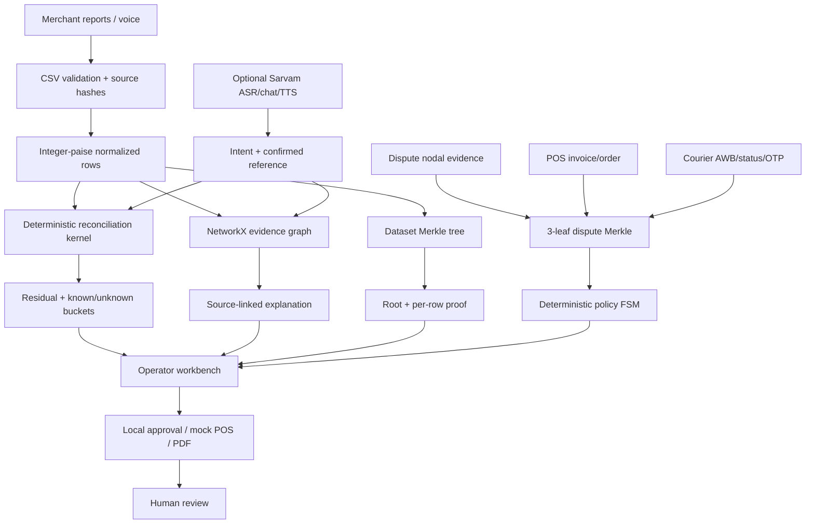

# SettleGraph — implementation and judge guide

## Product framing

**SettleGraph is an evidence-first merchant operations teammate that explains exceptions by linking source reports, not by asking a chatbot to guess.** It complements payment-provider dashboards: the differentiator is cross-system correlation across provider settlement, merchant bank, POS/order, courier and operator evidence.

The current package is a local proof-of-concept. Built-in fixtures are synthetic. No live Paytm, NPCI, bank, POS or courier calls are enabled. No refund or dispute submission can execute.

## Architecture at a glance

## Core algorithms

### Fixed-point paise reconciliation

- Rupee strings are parsed through `Decimal` in the provider CSV adapter.
- Canonical financial fields are stored as integer paise.
- The core totals gross capture, batch-assigned amounts and source-recorded adjustments, then compares expected net with exact matching bank credit(s).
- Reconciliation status is driven by issues, unknown adjustment categories and residual.
- The demo fixture produces ₹50,000.00 gross, ₹45,718.60 selected bank credit and ₹4,281.40 explained by synthetic source rows plus a transaction assigned to a different batch. Residual is ₹0.00.

**Important:** the code does not calculate MDR from a universal RuPay/PPI rule. The fixture's ₹90 MDR, ₹16.20 GST and ₹0.20 switch-fee are explicit synthetic source rows. The uploaded Gemini prompts contain conflicting MDR assumptions; they must not be presented as verified Paytm tariff rules.

### Batch and midnight logic

The current kernel deliberately requires an explicit payout batch ID. `analyse_cutoff_events()` is implemented as a bounded two-pointer window over sorted capture/nodal event views, matched by exact transaction ID, with invalid, ambiguous and unmatched references surfaced. These two timestamps are currently carried on the same normalized transaction rows; production still requires independent authoritative capture and nodal feeds plus stable IDs, timezone/cutoff semantics and clock-skew handling. The event analyser explains timing and does not establish payout membership.

### Dataset Merkle vs. dispute Merkle

- Dataset Merkle fingerprints rows from transactions, adjustments, settlement batches and bank credits.
- Dispute Merkle fingerprints three domains: nodal payment (`UTR/status/amount`), POS/order (`order/status/invoice amount`) and courier (`AWB/status/OTP verified`).
- A fault changes the relevant leaf and root; inclusion proofs can be verified.
- A cryptographic hash cannot prove who generated the source row. Provider signatures, authenticated API retrieval or another trusted source mechanism are needed for authenticity.

### Policy safety

A clean synthetic evidence set becomes `READY_FOR_HUMAN_REVIEW`, not “dispute won” or “POD uploaded”. OTP missing, amount mismatch or courier conflict produces a proof/consistency hold. Duplicate-debit is staged for human approval. `external_submission_enabled` remains false.

### Voice and agent

- Sarvam is optional and requires a backend-only key.
- Chat model tool selection is restricted to backend allow-listed read-only operations. Deterministic kernel methods own the money values and statuses.
- Saaras ASR output is text to be reviewed. Levenshtein matching provides candidates, never silent financial joins.
- TTS speaks backend-generated text; a browser speech synthesis fallback is available.
- Offline fallback is labelled. A provider outage does not fabricate an ASR transcript or claim a live model answer.

## Why the app uses SQLite instead of PostgreSQL `SKIP LOCKED`

SQLite makes the hackathon workbench portable and easy to run on a Windows laptop. It persists local datasets, staged imports, approval records, investigations and audit events. It is not the production concurrency design in the slide. PostgreSQL, migrations, concurrent worker locking and external immutable audit anchoring remain deployment work.

## Three-minute demo and judge defence

**0:00–0:25 — Problem:** “A merchant sees the amount collected, a different bank credit, and multiple disconnected reports. SettleGraph gives the operator a source-backed explanation rather than a guessed answer.”

**0:25–0:55 — Reconcile:** Show gross, current batch gross, shifted rows, explicit adjustment rows, expected bank payout and residual. Call out the fixture's synthetic label. Then point to the capture→nodal event panel: 143/143 exact ID pairs, one cross-date event and ₹1,850.00 cross-date amount. State that payout batch assignment still comes from the explicit source batch field.

**0:55–1:20 — Evidence graph:** Select a source node. Explain the explicit batch reference, exact payout UTR and source row.

**1:20–1:50 — CSV stage:** Preview raw Paytm-style export and inspect the header map. Stage it with an operator-supplied payout mapping. Show that it does not replace the canonical active ledger until companion reports and validations exist.

**1:50–2:20 — Break-the-case:** Evaluate the synthetic dispute case, record the three-way Merkle root, corrupt OTP or invoice amount, re-evaluate and show root/state change.

**2:20–2:40 — Human gate and operations:** Stage duplicate-debit approval; show approve/reject only records a manual handoff. Demonstrate idempotent local mock POS sync.

**2:40–3:00 — Voice/PDF:** If live Sarvam was tested, show the labelled live mode. Otherwise show offline fallback. Generate the evidence packet and state it is not a provider submission.

## Judge Q&A

**Q: Is this an LLM wrapper?**  
No. Money arithmetic, exact matching, graph construction, Merkle hashing, policy states and idempotency are deterministic backend functions. Sarvam is an optional perception/tool-selection layer over a read-only allow-list.

**Q: Why not let the model explain the rupee difference directly?**  
The model does not get to calculate balances. The backend computes integer-paise values and returns the explanation buckets plus source records. The model can summarise that result, but cannot change it.

**Q: Is the system integrated with Paytm/NPCI?**  
No live provider integration is part of this local build. It accepts local reports and has a Paytm-style export adapter/staging flow. Provider integrations require approved credentials, contracts, source semantics and security review.

**Q: Where is the two-pointer cutoff algorithm?**  
`backend/engine.py:analyse_cutoff_events()` builds sorted capture/nodal event views and advances lower/upper time-window pointers. It matches only exact transaction IDs; the window bounds candidate pairing and diagnoses cross-date events. It does not assign batches. Today those event fields come from the normalized local fixture/import row, so independent authoritative provider event feeds remain a production requirement.

**Q: Does midnight decide the payout batch?**  
No. Only explicit source `payout_batch_id` and payout UTR/batch references decide batch membership. Midnight analysis is an explanation of event timing, not a replacement for the provider's batch reference.

**Q: Does the fake UTR screen prove fraud?**  
No. It only reports whether the UTR matches the currently loaded dataset. A real fraud verdict needs an authoritative provider/switch lookup and a defined time/scope.

**Q: Is the Merkle root proof of delivery?**  
No. It proves that the currently supplied nodal, POS and courier fields have not changed relative to the captured root. Authenticity requires trusted source identity/signatures and completeness checks.

**Q: Can you auto-defend UDIR/RGNB?**  
This build checks synthetic evidence consistency and prepares a local review packet. It does not upload a dispute. UDIR and RGNB are distinct schemes/roles and must be modelled against the current authoritative rule catalogue and provider API permissions.

**Q: Does RBI require ₹100/day for all disputes?**  
No. Do not generalise that compensation rule to all UDIR/RGNB representment cases. The applicable RBI failed-transaction TAT has specific transaction categories, triggers and clocks. The current build does not calculate a universal dispute penalty.

**Q: What if Sarvam or Wi-Fi fails?**  
The agent reports a labelled deterministic offline fallback. ASR returns no transcript if it cannot reach the service; the operator must type the request or retry. TTS may use browser speech synthesis.

**Q: What is still missing for production?**  
Authentication/tenant isolation, PostgreSQL concurrency, authoritative vendor adapters, versioned policy rules, provider sandbox approvals, audit anchoring, security review and frontend browser e2e verification.

## Code reading order

Read `seed_data.py` → `engine.py` → `paytm_settlement_adapter.py` → `main.py` → `store.py` → tests → `sarvam_service.py` → `pdf_compiler.py` → `frontend/src/App.tsx` → `frontend/src/styles.css`.

The exact implementation/gap state is in `IMPLEMENTATION_STATUS.md`, `GAP_REGISTER.md` and `PROJECT_AUDIT.md`.

## Vendor & Exceptions Desk — merged v4 extension

The separate v4 ZIP contributed an additional Vendor & Exceptions section. This is an adjacent capability, not a replacement for the shortlisted Paytm merchant-operations story. `frontend/src/VendorTab.tsx` calls the vendor routes in `backend/main.py`; deterministic calculations and fixtures live in `backend/vendor.py`; regression coverage lives in `backend/tests/test_vendor.py`.

Current local functions:

- PO/GRN/invoice amount and delivery review over one built-in synthetic vendor record.
- Dated partial-payment and note ledger, outstanding amount and source flags.
- MSMED timeline aid with written objection/acceptance and payment-term checks. Recorded Udyam/category/activity fields are not independently authenticated.
- Interest illustration that remains blank until an operator enters and explicitly confirms a bank-rate assumption and all principal-changing events have dates. It uses a single input rate and simplified monthly-rest treatment; it is not a legal/accounting statement.
- Vendor follow-up stages a local human-approval entry; it does not send an email, WhatsApp or ERP action.
- RBI failed-transaction view separates UPI P2M confirmation-missing T+5 from P2P beneficiary-not-credited T+1. ₹100/day is shown as a potential scenario only for those categories and must not be generalised to UDIR/RGNB cases.
- Kirana payout and the vendor invoice are synthetic fixtures. The exception inbox combines the relevant local settlement/duplicate/vendor items.
- The small Hinglish router is deterministic intent matching over backend-computed ledger values, not a broad language model.

For a live product, add verified vendor ERP imports, Udyam source verification, current RBI rate history and counsel-reviewed Section 15/16 calculations before using this module for legal notices or statutory interest. Do not claim it is integrated with a vendor portal today.

## Current version and test state

This merged build is version 0.5.0 and the backend suite contains **107 passing tests**. `App.tsx`, `VendorTab.tsx` and `main.tsx` pass TypeScript syntax transpilation. The full TypeScript project build, Vite production bundle and browser end-to-end test remain unverified until run on the target Windows machine with npm dependencies installed. See `IMPLEMENTATION_STATUS.md` and `LIVE_READINESS_ROADMAP.md`.
